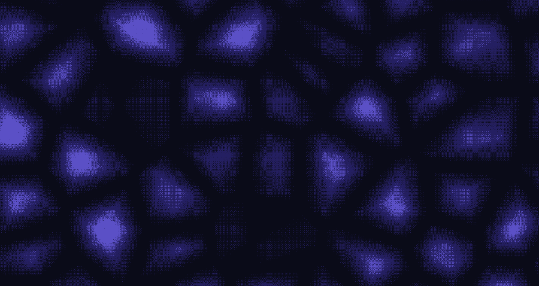
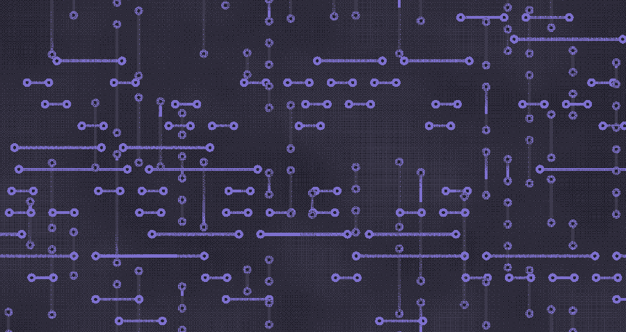

# Pixeldish

Dithered procedural wallpapers for macOS. A small native menu bar app written
in Swift and Metal. It has no dock icon and no dependencies.

<p>
  
  
</p>

## Features

- 20 shape generators: drift, shepard, sines, fringe, curtain, voronoi, contour,
  vortex, sweep, glitch, twill, belts, circuit, julia, kali, torus, kerr, binary,
  cygnus, pipes
- kerr ray traces a Kerr null geodesic per pixel onto a Page-Thorne disk with
  g^4 beaming; the selftest checks the shadow against Bardeen's analytic edge.
  binary superposes two Schwarzschild lenses, cygnus is a hole fed by a
  Roche-lobe-filling supergiant
- per-shape knobs: torus size, thickness, tumble, chase and windings; kerr spin
  (0 is Schwarzschild), inclination, mass, disk temperature and radius; binary
  mass ratio, separation, inclination, orbit speed, disk temperature; cygnus
  star mass, inclination, orbit speed, stream, disk temperature; pipes pipe
  radius, joint style (elbows, spheres, mixed), grid scale, travel speed and
  highlight shine. On the black holes warp is disk turbulence
- patterns with ids: every look has a UUID derived from its content, so the same
  picture has the same id on any machine. Copy pattern / Paste pattern move it
  as one line of KYAML
- config in `~/.config/pixeldish/config.kyaml`, and a nix-darwin module that sets
  everything down to the exact pattern
- 13 dithers: smooth, poster, bayer 2/4/8/16, R2 (plastic-constant
  quasirandom), interleaved gradient noise, halftone, lines, diamond, ascii,
  benday
- 20 palettes (Dracula Pro, Van Helsing, Catppuccin Mocha/Latte, Nord, Gruvbox,
  Tokyo Night, Rose Pine and more), plus a custom one: pick five colours or
  build it from a photo
- stops drawing when a display is fully covered, holds the frame in Low Power
  Mode
- shuffle every hour
- hyper: demo mode that draws at the display's top refresh rate (120 Hz on
  ProMotion)
- live animated desktop layer on every display, or a still frame
- use a photo as the source image
- export a PNG for each display
- saved looks, history, launch at login
- keeps the system wallpaper in step: Mission Control, the lock screen and the
  desktop after quitting show a still of the current look
- screen saver: the app installs Pixeldish.saver into `~/Library/Screen Savers`
  on launch; pick it in System Settings > Screen Saver to get the current look
  when idle and on lock

Each shuffle or reseed takes a new seed from the clock. The seed changes more
than the noise offset: it also picks scale, spiral direction and drift.

## Install

```sh
brew tap dappermint/tap
brew trust --cask dappermint/tap/pixeldish
brew install --cask pixeldish
```

`brew trust` is needed once, because Homebrew won't load a cask from a
third-party tap until you trust it. Update with `brew upgrade --cask pixeldish`,
remove with `brew uninstall --zap --cask pixeldish` (also deletes prefs, the screen saver and the synced wallpaper stills).

Or grab the dmg from [Releases](../../releases) and drag Pixeldish to
Applications. It is ad-hoc signed and not notarized, so the first launch needs
right-click, then Open.

Or build it yourself (below) and run `just install`.

## Usage

Click the grid icon in the menu bar:

| item | key |
|---|---|
| Editor | ⌘E |
| Shuffle | ⌘R |
| Previous | ⌘P |
| Save look | ⌘S |
| Copy pattern | ⌘C |
| Paste pattern | ⌘V |
| Quit | ⌘Q |

The editor has every knob: shape, dither, palette, colour count, pixel size,
warp, contrast, grain, vignette, zoom, spread, speed, invert, animate, hyper
and hourly shuffle.

## Patterns and config

The app keeps its config in `~/.config/pixeldish/config.kyaml` and rewrites it
on every change. [KYAML](https://kubernetes.io/docs/reference/encodings/kyaml/)
is the strict flow-style YAML subset kubectl emits, so any YAML tool reads it:

```yaml
{
  settings: {animate: true, autoShuffle: false, hyper: false},
  pattern: {
    shape: "Kerr",
    palette: "Dracula Pro",
    dither: "Bayer 8",
    params: {spin: 0.95, inclination: 84, temperature: 1.3},
  },
  saved: [],
}
```

Fields left out take their defaults. Shape, dither and palette go by name; a
`Custom` palette carries its five colours in `custom: ["#rrggbb", ...]`. A
pattern's id is a UUIDv5 of its canonical form without the name, so renaming
keeps it and any other change makes a new one. Copy pattern puts the active
pattern on the clipboard as one line, with its id; Paste pattern takes that or
the id of a saved pattern.

`Pixeldish --check file.kyaml` validates a config or a single pattern, prints
each pattern's id and fails on unknown names, params or out-of-range values:

```sh
/Applications/Pixeldish.app/Contents/MacOS/Pixeldish --check ~/.config/pixeldish/config.kyaml
```

### nix-darwin

```nix
{
  inputs.pixeldish.url = "github:dappermint/pixeldish";

  # in the darwinSystem modules
  imports = [ inputs.pixeldish.darwinModules.default ];
  services.pixeldish = {
    enable = true;
    settings.animate = true;
    pattern = {
      shape = "Kerr";
      palette = "Dracula Pro";
      dither = "Bayer 8";
      params = { spin = 0.95; inclination = 84; };
    };
    # or paste what Copy pattern gave you
    saved = [ ''{shape: "Torus", palette: "Dusk", params: {windings: 9}}'' ];
  };
}
```

The module installs the app, starts it at login through launchd (leave the
app's Launch at login off) and writes `/etc/pixeldish/config.kyaml`, which wins
over the user file: its pattern applies at launch and on every switch that
changes it, tweaks in the app last until then. `pattern` also takes the id of
a `saved` entry. The generated file goes through `--check` at build time, so a
misspelt name fails the switch instead of falling back. The package builds with
the Command Line Tools' `swiftc`, so it needs `sandbox = false` (the darwin
default) or `relaxed`.

## Building

Needs macOS 14+, the Xcode Command Line Tools and [`just`](https://github.com/casey/just).

```sh
just build      # build/Pixeldish.app
just install    # icon + build, copy to /Applications
just run        # install, then launch
just test       # selftest + palette/dither audit
just audit      # palette/dither audit only
just test-live  # check the live desktop window actually draws
just sheet      # build/contact-sheet.png with every shape x dither
just dmg        # build/Pixeldish-<version>.dmg
just uninstall  # remove the app and its prefs
```

`nix develop` gives a shell with `just` and pinned `swiftformat` and
`swiftlint` for `just fmt` and `just lint`.

The shader is compiled at build time with `xcrun metal`, so building needs
Xcode with the Metal Toolchain (`xcodebuild -downloadComponent MetalToolchain`),
not just the Command Line Tools. It ships as `Contents/Resources/shader.metallib`.

## Layout

| path | what |
|---|---|
| `src/main.swift` | entry point: CLI modes, then the app |
| `src/app/` | menu bar, editor, wallpaper windows, prefs |
| `src/render/` | shader, renderer, palettes, ASCII atlas |
| `src/checks/` | selftest, built into the app |
| `dev/` | dev-only checks, not shipped (palette/dither audit) |
| `tools/make-icon.swift` | generates the app icon |

## Tests

`--selftest`, `--sheet` and `--capture <path> [w h]` are modes of the app
binary. The audit lives in `dev/` and `just audit` builds it against the same
renderer into a separate binary, so it never ships but cannot drift either.
New dev-only checks go in `dev/` the same way.

Each dither maps the field onto the palette. So anything that darkens or
roughens the image has to change the field first. If you change the colour
afterwards, you get colours that aren't in the palette, and they look like
noise. The audit checks that, plus:

- palette ramps go up in luminance, and no step is too small to dither or big
  enough to blotch
- no dither puts out a colour that isn't in the palette (`smooth` is the one
  exception, it is the plain gradient)
- each dither reaches every palette level the shape covers
- a 2-colour render has exactly 2 colours
- N colours span the whole palette, not just its N darkest entries
- adjacent saturated entries are at most 90° apart in hue, so the dither does
  not shimmer
- `spread` really does widen a narrow shape's range

## Contributing

Issues and PRs are welcome. Run `just lint` and `just test` before you open a PR.

## License

MIT, see [LICENSE](LICENSE).
